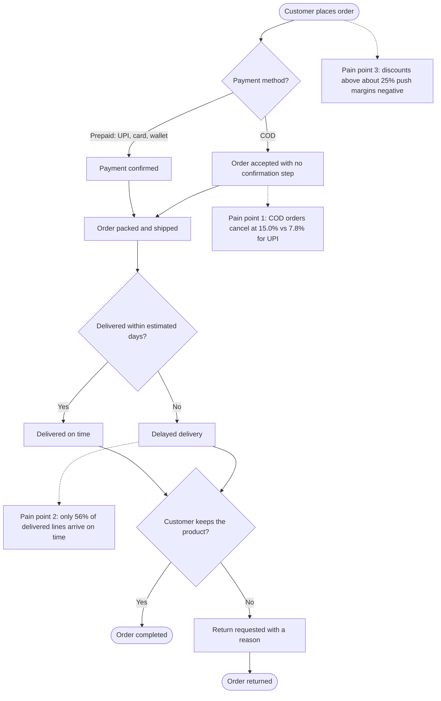
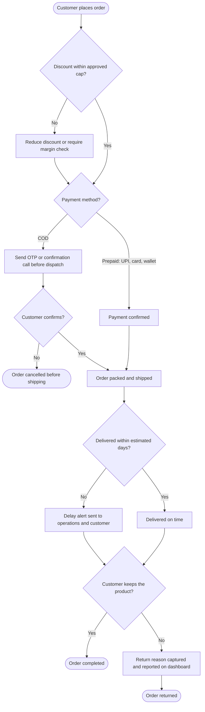

# Process Map: Nykaa Order-to-Delivery (As-Is and To-Be)

**Version:** 1.0 | **Author:** Tanishka Gaikwad | **Status:** Sample / portfolio document

> **Note:** This map is an illustrative exercise based on the simulated Nykaa dataset used in the Power BI report. The steps are assumed, and the percentages come from the dashboard measures (see the BRD for definitions).

## 1. As-Is Process

## 2. To-Be Process (proposed improvements)

## 3. Pain Points and Proposed Changes

| # | Pain point (as-is) | Evidence | Proposed change (to-be) | Success measure |
|---|---|---|---|---|
| 1 | COD orders are accepted without confirmation | COD cancellation 15.0% vs 7.8% for UPI | OTP or confirmation call before dispatch; incentive to pay prepaid | Cancellation Rate % for COD |
| 2 | Late deliveries are not flagged | 56% of delivered lines on time | Delay alerts; review weak city tiers | On-Time Delivery % |
| 3 | Deep discounts are not checked against margin | Margins turn negative above about 25% discount | Discount cap with margin check | Profit Margin % by discount band |
| 4 | Return reasons are not acted on | Return Rate % and return-reason chart on the dashboard | Review top return reasons monthly | Return Rate % |

## 4. Symbols Used

- **Rounded shape:** start or end of the process.
- **Rectangle:** an action or step.
- **Diamond:** a decision with two or more outcomes.
- **Dotted line to a note:** a pain point linked to the step where it occurs.
